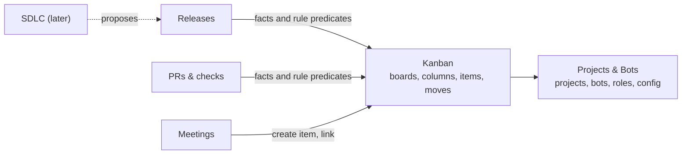

# Kanban rework (0.19.0)

Status: **proposal, awaiting owner approval** (#3). Nothing here is implemented yet.
App and linked-computer design: [kanban-rework-apps.md](kanban-rework-apps.md).

## Why

The board was built as the process of one team working on this repository.
It does not abstract over the projects a user creates:

- One board per project. Every board table, feed, mirror and protocol request
  is keyed by `project_id`.
- Columns are user-editable in name only. Their nine categories (`inbox` …
  `approval`, `deploying` … `cancelled`) are a closed enum in proto, Rust and a
  SQL `CHECK`. Every guard keys on them. Only the WIP limit can be changed.
- Columns can't be added, removed, reordered or given new rules, by the owner
  or by a bot. Templates and Definition-of-Ready fields are seeded once and can
  never be edited.
- Some values come from this repository's own team and product:
  - `Platform { desktop, ios, daemon, infra }`;
  - a DoR field `spec_link_for_ui_or_daemon`;
  - roles guessed from bot names ("desktop dev", "context engineer");
  - `H-017` examples in tool descriptions.
- Releases and PRs live inside the board module and move cards themselves.
  - `board::release::daemon_move` is called from about 15 places in the
    release and PR code.
  - The guards in turn read `item.release_id` and the open package.
  - Features and bugs can only reach Done through a release.
  - So a library, a docs site or a non-software project cannot use the board
    without inventing releases.
- Bots are never told when the board changes, and the owner cannot create or
  edit items from the desktop app.

## Target: separate modules

| Module | Owns | Must not |
|---|---|---|
| Projects & Bots | Projects, permanent bots, bot configuration and permissions, the project repository, **project roles** (named roles and their members, including the lead) | Know about boards |
| Kanban | Boards (many per project), columns, column rules, item types and templates, items, links, comments, history, moves, board-change notifications | Know about releases, PRs, meetings or deploys |
| Releases, PRs, Meetings | Their own records | Write Kanban tables; they go through `kanban::api` |

Only Kanban code writes Kanban tables. Other modules call one port,
`kanban::api`, through two seams. Kanban never imports them.

1. **Facts.** A module reports a fact about an item, for example
   `pr.opened`, `pr.merged` or `release.shipped`. Each board maps facts to
   columns in its *automations*. When a board has no mapping for a fact, the
   item stays where it is. Kanban never sees module names, only fact strings
   that modules register along with a description for the UI.
2. **Rule predicates.** A module can register a named, deterministic predicate,
   such as `release.in_open_package` or `pr.all_merged`. A column's entry rules
   may require it, and Kanban evaluates it through a trait.

Everything stays in one SQLite database and one transaction type. The boundary
is about which code owns which tables, not separate storage.

## Kanban model

### Board

`board(id, project_id, name, key, description, ord, archived_at, version,
structure_policy)`

- A project has zero or more boards; one may be marked default.
- `key` is the item-id prefix and stays unique across the daemon, so item ids
  (`KEY-12`) remain globally unique. The board-card guardrails (G1–G5) keep
  working unchanged.
- All boards of a project live on the project's **home** daemon, as today; see
  the apps doc.
- `structure_policy` says who may change the board's structure; see
  "Who changes structure".

### Column

`board_column(board_id, key, name, ord, kind, wip_limit, wip_scope, visible,
movers, rules, allowed_from)`

- `kind` is one of `open | active | done | cancelled`. Kanban needs only these
  four meanings: metrics (cycle time, throughput), staleness and WIP apply to
  `active` columns, and `done` and `cancelled` are terminal. Every other meaning
  comes from rules.
- `movers` says who may move an item into the column:
  - `any_member`, `assignee`, `lead`, `owner`, or a list of project roles;
  - `system`: only automations may move items in.
- `rules` is a list of entry rules from the library below. A move is refused
  with every unmet rule and its fix, as today.
- `allowed_from` is an optional list of columns an item may come from. Empty
  means any.
- Moving an item to an earlier column (lower `ord`) is a **return**. It is
  never refused for WIP, and it is logged, as `RETURNED_OVER_WIP` is today.

### Rule library (deterministic)

| Rule | Checks |
|---|---|
| `assignee_set` | The item has an assignee. |
| `fields_filled(sections…)` | The template sections named are filled in. Replaces the fixed DoR fields. |
| `ac_present` / `ac_all_checked` | Acceptance criteria exist, or all are checked. |
| `size_at_most(S\|M\|L)` | Size limit. |
| `blockers_done` | Blocking items are in a `done` column. |
| `not_blocked` | No `blocked` flag. |
| `link(kind)` | A link of that kind exists (task, artifact, pr, branch, …). |
| `independent(of)` | The mover is not the assignee or the linker of a pr/branch. |
| `reason` | The move carries a reason. |
| `predicate(name)` | A predicate registered by another module. |

Each rule's refusal text is generic and is generated from its parameters.

### Item types and fields

- **Types:** each board has its own item types, each with a name, a glyph and
  template sections. Defaults come from the board preset.
- **Platform enum:** removed. Items carry free `labels`. A board may declare
  *label groups*, for example `area: web, api` or `platform: ios, android`, so
  the UI can filter on them.
- **Size, priority and acceptance criteria:** stay generic, but each one can
  be turned off per board.

### Presets

A board is created from a preset and edited afterwards. Presets are data, not
code:

- **Simple:** To do (open) → Doing (active, WIP 3) → Done.
- **Software:** Inbox → Ready (`fields_filled`, `ac_present`) → Doing
  (`assignee_set`, WIP 1 per assignee) → Review (`link(pr)`) → Done.
  - Automations: `pr.opened` → Review; `pr.merged` → Done;
    `pr.closed` → Doing.
- **Release-gated:** today's flow for teams that want it. It adds Verify,
  Awaiting owner (`movers: system`) and Deploying (`movers: system`), with
  release automations. Existing boards migrate to this preset.

### Who changes structure

Structure means boards, columns, rules, automations, types and templates.

| Policy | Lead bot | Owner |
|---|---|---|
| `owner_confirms` (default) | Proposes a change. It is raised as a decision showing the change, and is applied when the owner approves it. | Edits directly |
| `lead_free` | Edits directly. The owner is notified, with one-click undo. | Edits directly |

Cosmetic edits (rename, reorder, WIP limit, visibility) always apply directly,
with a notice. Every structure change is a board event in the board's history.

### Bots find out

- Structure changes and owner edits to items create **board events**.
- **Bot notices:**
  - the lead gets a short notice for every change it did not make;
  - an assignee gets one when the owner or another bot moves or edits their
    item.
  - Notices are batched for up to 60 s and capped by the existing note budget.
- **Version checks:** `board_get` returns the board's `version`. A tool call
  with a stale `board_version` is refused with "the board changed; re-read it".
- **System prompt:** the board section is generated from the board's columns
  and automations. The hard-coded "PR opened → Review, merge → Verify" text in
  `paths/prompt_sections.rs` is removed.

## Interfaces

**MCP** (bots):

| Tools | Who may call them |
|---|---|
| `board_list`, `board_get(board?)` | Everyone |
| `board_create(preset\|columns)`, `board_update`, `board_archive` | Lead, under the structure policy |
| `column_add`, `column_update`, `column_move`, `column_remove(move_items_to)` | Lead, under the structure policy |
| `type_upsert`, `template_upsert`, `automation_set` | Lead, under the structure policy |

- The item tools are unchanged, except that `item_create` takes `board?`, which
  defaults to the default board.
- Release, PR and meeting tools leave the board dispatcher. They no longer
  require a board to exist or use board roles; they use project roles.

**WebSocket** (apps):

- A new `hermes.kanban.v1` package mirrors the MCP set for the owner.
- It also serves the item edits that are refused over WebSocket today:
  create, update, assign, rank, link, block and checking acceptance criteria.
- Pushes:
  - `BOARD_ADDED`, `BOARD_CHANGED`, `BOARD_ARCHIVED`, `COLUMNS_CHANGED` (now
    emitted on every structure change), `ITEM_*`;
  - each push carries `board_id`.

**Compatibility:** `hermes.board.v1` stays served for one minor release as a
shim over the default board. It covers the phone app pinned to the 0.17.5
contract and 0.18 linked computers.

## Data migration

The migration is one-way, runs at daemon start, and is preceded by an automatic
`hermesd backup`.

1. Create one `board` per `board_settings` row. Keep the same `key` and name it
   "Main".
2. Add `board_id` to `board_column`, `item` and `template`.
3. Map each column category to a kind:

   | Category | Kind |
   |---|---|
   | `inbox`, `ready` | `open` |
   | `doing`, `review`, `verify`, `approval`, `deploying` | `active` |
   | `done` | `done` |
   | `cancelled` | `cancelled` |

   The rules, movers and automations that reproduce today's guards come from
   the Release-gated preset.
4. Convert `platforms` to labels (`platform:<name>`) and add a `platform` label
   group.
5. Move `item.release_id` into `release_item`, which already holds it, and
   drop the column.
6. Store `project_role.role` as free text, with no `CHECK`. Remove name-based
   role guessing; roles come from the preset and from the owner.
7. Leave `required_machines` with Releases, keyed by label.

The Release-gated preset must pass the current guard test table before any
other change lands. That proves the migration keeps existing boards working.

## Steps

Each step is its own PR into the `release-0.19.0-kanban-rework` branch. The
branch is reviewed as one PR into `main` at the end.

| Step | Content | Done when |
|---|---|---|
| K0 | Fix: workers are told `git push origin HEAD:{branch}`, which the main-push deny always refuses when the branch is `main`. Protect the project's configured branch instead of the literal `main`. | A worker on a default project lands its push. |
| K1 | Module split with no behaviour change: `board/` becomes `kanban/`; `release/`, `prs/` and `meetings/` move out; add the `kanban::api` port; replace `daemon_move` callers with facts. | Every existing test passes unchanged. |
| K2 | Schema: `board` table, `board_id` everywhere, column `kind`, migration, labels. | The migration test on a copy of a real 0.18 database keeps every item, link and event. |
| K3 | Rule library, movers, automations, predicates. The Release-gated preset reproduces today's guards. | The guard test table passes against the preset. |
| K4 | Board management over MCP and WebSocket, structure policy, decisions for proposals, board events, bot notices, stale-version refusals, generated prompt section. | A lead bot creates and edits a board end to end on the double runtime. |
| K5 | Desktop UI (apps doc). | Ladle stories and visual baselines exist for every new view. |
| K6 | Linked computers: a mirror per board, `board_id` in peer frames, a 0.18 peer compatibility path. | A bot on a linked computer edits a board homed on another computer. |
| K7 | Phone app (separate repository): vendored `kanban.v1`, board picker, live sync, move, quick add, approving proposals. | Works against a 0.19 daemon and still reads a 0.18 one. |
| K8 | Remove what was specific to this repository: the Platform enum, `spec_link_for_ui_or_daemon`, `H-017` examples, name-based role guessing, iOS-only machine constants in Kanban. | A search for these terms in `crates/hermesd/src/kanban` finds nothing. |
| K9 | Acceptance on a **fresh test project unrelated to this app**, on this computer and one linked computer. | See below. |

### Acceptance scenario (K9)

1. Create a project and two bots. Make one the lead.
2. The owner and the lead agree on a board. The lead calls `board_create`
   with the Simple preset. Under `owner_confirms`, the owner approves the
   proposal in Needs you.
3. The owner adds a "QA" column by hand in the desktop app. The lead is
   notified and its next `board_get` shows the column.
4. Items flow To do → Doing → QA → Done. A refusal names the missing rule.
5. A second board, "Research", is created from the phone app's approval of a
   proposal.
6. A bot on a linked computer moves an item. Reads still work while the home
   computer is offline; writes are refused with the home's name.
7. Nothing in the project mentions desktop, iOS, daemon or releases.

## Out of scope for 0.19.0

These are the next steps, each with its own plan:

- One active release per project, the always-visible release chip, and the
  rule "Doing only for items in the active release".
- The SDLC planning run that ends in a release proposal.
- Watchdogs: the daemon detects stale items, unmoved cards, unreviewed or
  unmerged PRs and missed release dates, and nudges the right bot, then the
  lead, then the owner. Bots fix; the daemon re-checks.
- Code-host integration (PR state from GitHub, later GitLab), and branch
  protection keyed to the project's configured branch beyond K0.
- Removing the remaining repository-specific values in Projects & Bots:
  `scripts/dev.sh`, `serve/*.sh`, the cargo/pnpm-only trusted commands, and
  hard-coded `main` in the PR and release code.

## Open questions for the owner

1. Is `owner_confirms` the right default for structure changes by the lead?
2. Should all of a project's boards share one home computer? The proposal
   says yes.
3. Should a fact with no mapping on a board be ignored silently, or shown on the
   card as "PR merged — no column mapped"? The proposal shows it on the card.
4. Phone scope for 0.19.0: is reading, moving, quick add and approving proposals
   enough, leaving board editing to the desktop?
