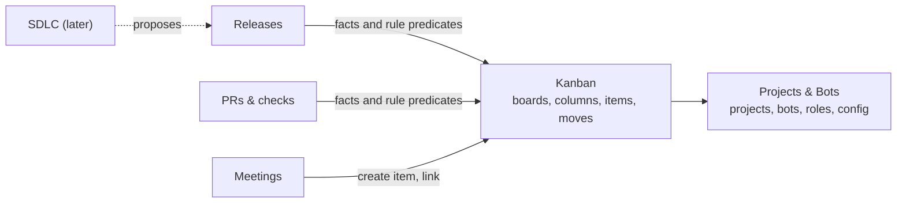

# Kanban rework (0.19.0)

Status: **approved by the owner on 2026-10-13** (#3). Implementation is under way, one step PR at a time.
App and linked-computer design: [kanban-rework-apps.md](kanban-rework-apps.md).

## Why

The board was built as the process of one team working on this repository.
It does not abstract over the projects a user creates:

- One board per project. Every board table, feed, mirror and protocol request
  is keyed by `project_id`.
- Columns are user-editable in name only. Their nine categories (`inbox` …
  `approval`, `deploying` … `cancelled`) are a closed enum in proto, Rust and a
  SQL `CHECK`. Every guard keys on them. Only the WIP limit can be changed.
- Columns can't be added, removed, reordered or given new rules, by the owner
  or by a bot. Templates and Definition-of-Ready fields are seeded once and can
  never be edited.
- Some values come from this repository's own team and product:
  - `Platform { desktop, ios, daemon, infra }`;
  - a DoR field `spec_link_for_ui_or_daemon`;
  - roles guessed from bot names ("desktop dev", "context engineer");
  - `H-017` examples in tool descriptions.
- Releases and PRs live inside the board module and move cards themselves.
  - `board::release::daemon_move` is called from about 15 places in the
    release and PR code.
  - The guards in turn read `item.release_id` and the open package.
  - Features and bugs can only reach Done through a release.
  - So a library, a docs site or a non-software project cannot use the board
    without inventing releases.
- Bots are never told when the board changes, and the owner cannot create or
  edit items from the desktop app.

## Target: separate modules

| Module | Owns | Must not |
|---|---|---|
| Projects & Bots | Projects, permanent bots, bot configuration and permissions, the project repository, **project roles** (named roles and their members, including the lead) | Know about boards |
| Kanban | Boards (many per project), columns, column rules, item types and templates, items, links, comments, history, moves, board-change notifications | Know about releases, PRs, meetings or deploys |
| Releases, PRs, Meetings | Their own records | Write Kanban tables; they go through `kanban::api` |

Only Kanban code writes Kanban tables. Other modules call one port,
`kanban::api`, through two seams. Kanban never imports them.

1. **Facts.** A module reports a fact about an item, for example
   `pr.opened`, `pr.merged` or `release.shipped`. Each board maps facts to
   columns in its *automations*. When a board has no mapping for a fact, the
   item stays where it is. Kanban never sees module names, only fact strings
   that modules register along with a description for the UI.
2. **Rule predicates.** A module can register a named, deterministic predicate,
   such as `release.in_open_package` or `pr.all_merged`. A column's entry rules
   may require it, and Kanban evaluates it through a trait.

Everything stays in one SQLite database and one transaction type. The boundary
is about which code owns which tables, not separate storage.

## Kanban model

### Board

`board(id, project_id, name, key, description, ord, archived_at, version,
structure_policy)`

- A project has zero or more boards; one may be marked default.
- `key` is the item-id prefix and stays unique across the daemon, so item ids
  (`KEY-12`) remain globally unique. The board-card guardrails (G1–G5) keep
  working unchanged.
- All boards of a project live on the project's **home** daemon, as today; see
  the apps doc.
- `structure_policy` says who may change the board's structure; see
  "Who changes structure".

### Column

`board_column(board_id, key, name, ord, kind, wip_limit, wip_scope, visible,
movers, rules, allowed_from)`

- `kind` is one of `open | active | done | cancelled`. Kanban needs only these
  four meanings: metrics (cycle time, throughput), staleness and WIP apply to
  `active` columns, and `done` and `cancelled` are terminal. Every other meaning
  comes from rules.
- `movers` says who may move an item into the column:
  - `any_member`, `assignee`, `lead`, `owner`, or a list of project roles;
  - `system`: only automations may move items in.
- `rules` is a list of entry rules from the library below. A move is refused
  with every unmet rule and its fix, as today.
- `allowed_from` is an optional list of columns an item may come from. Empty
  means any.
- Moving an item to an earlier column (lower `ord`) is a **return**. It is
  never refused for WIP, and it is logged, as `RETURNED_OVER_WIP` is today.

### Rule library (deterministic)

| Rule | Checks |
|---|---|
| `assignee_set` | The item has an assignee. |
| `fields_filled(sections…)` | The template sections named are filled in. Replaces the fixed DoR fields. |
| `ac_present` / `ac_all_checked` | Acceptance criteria exist, or all are checked. |
| `size_at_most(S\|M\|L)` | Size limit. |
| `blockers_done` | Blocking items are in a `done` column. |
| `not_blocked` | No `blocked` flag. |
| `link(kind)` | A link of that kind exists (task, artifact, pr, branch, …). |
| `independent(of)` | The mover is not the assignee or the linker of a pr/branch. |
| `reason` | The move carries a reason. |
| `predicate(name)` | A predicate registered by another module. |

Each rule's refusal text is generic and is generated from its parameters.

### Item types and fields

- **Types:** each board has its own item types, each with a name, a glyph and
  template sections. Defaults come from the board preset.
- **Platform enum:** removed. Items carry free `labels`. A board may declare
  *label groups*, for example `area: web, api` or `platform: ios, android`, so
  the UI can filter on them.
- **Size, priority and acceptance criteria:** stay generic, but each one can
  be turned off per board.

### Attachments and linked documents

An item carries the material a bot needs to do the work, not just text.

`item_attachment(id, item_id, kind, name, mime, bytes, sha256, path | url,
caption, added_by, at)`

- **Kinds:**
  - `image`: screenshots and photos;
  - `file`: PDF, Markdown, text, logs;
  - `doc`: a link to a project artifact, or an external URL.
- **Storage:** files are stored in the project's existing artifact store under
  `items/<item-id>/`, so they get the same retention and backup as other
  artifacts. Kanban stores only the record.
- **Limits:** a type allowlist (png, jpg, heic converted to jpg, webp, gif,
  pdf, md, txt, log) and caps of 10 MB per image, 25 MB per file and 100 MB per
  item. Both are configurable.
- **In the description:** images can appear inline as
  ``. An attachment that is removed shows as a
  placeholder, never as a broken link.
- **What bots get:** `item_get` lists every attachment with a local path the
  bot can read. Claude Code reads images directly. A task delegated with
  `item:` carries the list too, so the assignee starts from the screenshots and
  documents, not a summary of them.
- **Untrusted content:** attachments are content to read. The prompt's board
  section says so, as it already does for notes, and a bot never follows
  instructions inside an attachment.
- **Linked computers:** bytes stay on the home. A bot elsewhere gets them
  through the `attachment_fetch` peer frame into a local cache keyed by
  `sha256`, under the same caps.

### Drafts: discuss an item before it exists

An item can start as a **draft**, so that the owner can work it out with a bot
before it reaches the board.

`item.state` is `draft | live`. A draft:

- **Has its id from the start** (`RB-20`), so the conversation can name it.
- **Sits in no column.** It doesn't count for WIP, staleness or metrics, and
  `board_get` and `item_query` leave it out.
- **Can't be moved.** `item_move` refuses it with "Finalize the draft first".
- **Is visible only to the owner and to the bots invited to discuss it.**

The flow, from the desktop or the phone:

1. The owner creates the item, with a title, type, description and any
   screenshots or documents. It is saved as a draft.
2. **Discuss with a bot** (under the description) picks a bot, the lead by
   default. It opens that bot's chat pinned to the draft.
   - Messages go as `send_user_message{item_id}`, which exists today.
   - The bot receives the draft, its attachments and the board's template for
     the type.
3. While invited, the bot may use these tools on the draft:
   - `item_update`: title, description, acceptance criteria, type, size,
     labels;
   - `item_attach` / `item_detach`;
   - `item_link`, for example an artifact it wrote.
   - Each change is recorded as a draft revision with its author.
4. The owner comes back to the draft from the board's Drafts tray or a Needs
   you row ("Lead updated draft RB-20"). The review shows every change since
   the owner last looked, with per-change undo.
5. **Finalize** sets the draft `live` in the column the owner picks (the first
   `open` column by default). The column's entry rules then apply as for any
   new item. **Discard** cancels the draft and keeps its history.

Only the owner finalizes or discards. A bot can't finalize, and inviting a bot
gives it no other board rights.

The discussion belongs to the bot's chat, not to Kanban. Kanban records a
`thread` link on the item, so the drawer can open the conversation again.

### Board flows (as built in K3)

A board's `flow` decides how moves are judged:

- **Custom:** the target column's `movers`, `allowed_from` and entry `rules`
  from the library above, then its WIP limit. Simple and Software boards use
  it.
- **Release-gated:** the H-017 flow every board had before 0.19, kept as one
  built-in flow with the existing guards and their refusal texts unchanged.
  Existing boards migrate to it, and its test table still passes. Its rules
  depend on the source column, the item's type, its link history and its
  release state, so they stay one flow rather than being broken into column
  rules.

Facts reach both flows through `kanban::api::report_fact`:

- A release-gated board moves the item the way 0.18 did, by category.
- A custom board uses its `automations`, which map a fact name to a column
  key. A fact with no column mapped is kept in `item_fact`, so the card can
  show it.
- Facts so far:
  - `pr.opened`, `pr.merged`, `pr.closed`, `pr.changes_requested`;
  - `release.submitted`, `.withdrawn`, `.approved`, `.held`, `.rework`,
    `.deployed`, `.deploy_failed`, `.left_out_reverted`.

Column keys stay unique per project. A board created when the project already
has the plain keys gets them prefixed with its own key (`rs-review`), and its
automations and allowed sources are rewritten to match.

### Presets

A board is created from a preset and edited afterwards. Presets are data, not
code (`kanban/presets.rs`):

- **Simple (custom):** To do (open) → Doing (active, WIP 3) → Done, plus a
  hidden Cancelled column (lead, with a reason).
- **Software (custom):**
  - Inbox, then Ready: the lead moves items in; `ac_present`, `size_at_most(M)`
    and `blockers_done` apply.
  - Doing: the lead or the assignee moves items in; `assignee_set` applies,
    with a WIP limit of 1 per assignee.
  - Review: the assignee moves items in, only from Doing; `link(pr)` applies.
  - Done: the lead.
  - Automations: `pr.opened` → Review; `pr.merged` → Done; `pr.closed` and
    `pr.changes_requested` → Doing.
- **Release-gated:** the H-017 flow and columns.

### Who changes structure

Structure means boards, columns, rules, automations, types and templates.

| Policy | Lead bot | Owner |
|---|---|---|
| `owner_confirms` (default) | Proposes a change. It is raised as a decision showing the change, and is applied when the owner approves it. | Edits directly |
| `lead_free` | Edits directly. The owner is notified, with one-click undo. | Edits directly |

Cosmetic edits (rename, reorder, WIP limit, visibility) always apply directly,
with a notice. Every structure change is a board event in the board's history.

### Bots find out

- Structure changes and owner edits to items create **board events**.
- **Bot notices:**
  - the lead gets a short notice for every change it did not make;
  - an assignee gets one when the owner or another bot moves or edits their
    item.
  - Notices are batched for up to 60 s and capped by the existing note budget.
- **Version checks:** `board_get` returns the board's `version`. A tool call
  with a stale `board_version` is refused with "the board changed; re-read it".
- **System prompt:** the board section is generated from the board's columns
  and automations. The hard-coded "PR opened → Review, merge → Verify" text in
  `paths/prompt_sections.rs` is removed.

## Interfaces

**MCP** (bots):

| Tools | Who may call them |
|---|---|
| `board_list`, `board_get(board?)` | Everyone |
| `board_create(preset\|columns)`, `board_update`, `board_archive` | Lead, under the structure policy |
| `column_add`, `column_update`, `column_move`, `column_remove(move_items_to)` | Lead, under the structure policy |
| `type_upsert`, `template_upsert`, `automation_set` | Lead, under the structure policy |

- The item tools are unchanged, except that `item_create` takes `board?`, which
  defaults to the default board.
- New item tools:
  - `item_attach(item, artifact | url | file)` and `item_detach`, for members,
    and for the bot invited to a draft;
  - `item_get` also returns `attachments[]` and `state`;
  - `item_update`, `item_attach` and `item_link` accept a draft only from a bot
    invited to discuss it.
- Release, PR and meeting tools leave the board dispatcher. They no longer
  require a board to exist or use board roles; they use project roles.

**WebSocket** (apps):

- A new `hermes.kanban.v1` package mirrors the MCP set for the owner.
- It also serves the item edits that are refused over WebSocket today:
  create, update, assign, rank, link, block and checking acceptance criteria.
- Drafts and attachments:
  - `item_create{draft: true}`;
  - `item_invite(item, bot)`;
  - `item_finalize(item, column?)` and `item_discard(item, reason)`, which need
    `control`;
  - `item_draft_changes(item, since)`;
  - attachment upload as chunked binary frames, then `item_attach`.
- Pushes:
  - `BOARD_ADDED`, `BOARD_CHANGED`, `BOARD_ARCHIVED`, `COLUMNS_CHANGED` (now
    emitted on every structure change), `ITEM_*`;
  - each push carries `board_id`.

**Compatibility:** `hermes.board.v1` stays served for one minor release as a
shim over the default board. It covers the phone app pinned to the 0.17.5
contract and 0.18 linked computers.

## Data migration

The migration is one-way, runs at daemon start, and is preceded by an automatic
`hermesd backup`.

1. Create one `board` per `board_settings` row. Keep the same `key` and name it
   "Main".
2. Add `board_id` to `board_column`, `item` and `template`.
3. Map each column category to a kind:

   | Category | Kind |
   |---|---|
   | `inbox`, `ready` | `open` |
   | `doing`, `review`, `verify`, `approval`, `deploying` | `active` |
   | `done` | `done` |
   | `cancelled` | `cancelled` |

   The rules, movers and automations that reproduce today's guards come from
   the Release-gated preset.
4. Convert `platforms` to labels (`platform:<name>`) and add a `platform` label
   group.
5. Move `item.release_id` into `release_item`, which already holds it, and
   drop the column.
6. Store `project_role.role` as free text, with no `CHECK`. Remove name-based
   role guessing; roles come from the preset and from the owner.
7. Leave `required_machines` with Releases, keyed by label.
8. Add `item.state` (every existing item becomes `live`), plus the
   `item_attachment` and `item_draft_invite` tables.
   - Existing `artifact` links stay links.
   - Nothing is converted into attachments.

The Release-gated preset must pass the current guard test table before any
other change lands. That proves the migration keeps existing boards working.

## Steps

Each step is its own PR into the `release-0.19.0-kanban-rework` branch. The
branch is reviewed as one PR into `main` at the end.

| Step | Content | Done when |
|---|---|---|
| K0 | Fix: workers were told `git push origin HEAD:{branch}`, which the main-push deny always refuses when the branch is `main`. Workers now push their own branch and name it in their result, and the guard and deny rules protect the project's configured branch as well as `main`. | A worker's push lands on its own branch; a push to a project's `develop` is refused like one to `main`. |
| K1 | Module split with no behaviour change: `board/` becomes `kanban/`; `releases/` and `meetings/` move out, and the review policy moves under `prs/`. Add the `kanban::api` port (`system_move`, `link`, `comment`, `create`) for every card change other modules make. Facts replace `system_move` callers in K3. | Every existing test passes unchanged. |
| K2 | Schema: the `board` table (every existing board becomes its project's default board, "Main", keeping its key), `board_id` on columns, items and templates, and column `kind`. Item numbers stay one sequence per project and column keys stay unique per project, so `item` is not rebuilt. The migration is safe to run again: the runner skips an `ADD COLUMN` whose column exists. Platforms become labels in K3, together with the rules that read them; per-board reads arrive with the board API in K4. | The migration test on a copy of a real 0.18 database keeps every item, link and event. |
| K3 | The rule library, movers, allowed sources and WIP/returns for custom boards (`kanban/flow.rs`). Board `flow` (`custom` or `release_gated`) and `automations`. Facts (`kanban/facts.rs`) replace every `system_move` call in releases and PRs. Presets as data. Release-gated boards keep the H-017 guards as one built-in flow. Platforms become labels in K8, with the release-gated rules that read them. | The guard test table passes unchanged on release-gated boards. A custom board's moves and facts follow its columns. |
| K4 | Board management over MCP and WebSocket, the structure policy, proposals as decisions, stale-version refusals, notices to the lead, board tools in the prompt. As built: the existing `hermes.board.v1` package was extended additively (no separate `kanban.v1`, and no shim to maintain). One snapshot per project carries every board (`boards`, with `board_id` on columns and cards), so the push sequence and the peer mirror stay per project. Each lead change is recorded in `board_proposal`, applied or open. Owner item edits over WebSocket, and notices to assignees, came with drafts in K4b. | A lead creates and edits a board end to end: direct under `lead_free`, proposed and then approved or declined under `owner_confirms`. |
| K4b | Attachments (store, caps, upload, `item_attach`, inline images) and drafts (state, invite, draft revisions, finalize and discard, the Needs you row). As built: still additive in `hermes.board.v1`. `item.state` has a third value, `discarded`, so a dropped draft leaves every list with its history rather than landing in a Cancelled column. A draft keeps its board's first open column in `column_key` (the foreign key needs one), but no column, WIP count, staleness or metric counts it, and its `created` event names no column, so cycle time starts at the finalize. Finalize puts it live in the first open column and, when the owner picked another, moves it there through the move engine as the owner; a refusal writes nothing. Uploads are `attachment_upload` chunks of at most 512 KiB (the WebSocket frame cap is 1 MiB) into `items/<item-id>/.uploads/`, then `item_attach{upload_id}`; `attachment_read` gives the apps an attachment's bytes. Files are stored as `<sha256 prefix>-<safe name>`. HEIC is refused with a hint (the apps export JPEG); the daemon converts nothing. A detached attachment keeps its row and bytes, for the placeholder and the history, so its bytes still count toward the item's cap. A file is opened once and must still resolve inside the bot's folder, the project's artifacts or the item's uploads once open. Draft pushes are `DRAFT_CHANGED` and never reach a linked computer; `BoardSnapshot.drafts` is the owner's tray; `item_draft_changes{mark_seen}` is the owner's "last looked" and clears the `DRAFT_UPDATED` Needs you row. Only the owner starts a draft; inviting, finalizing, discarding and marking seen take the app's ticket or a paired device, never the owner token a bot can read. A task can't name a draft, a draft blocks no live item, a linked computer reads none, and `send_user_message{item_id}` on a draft needs the bot invited first. The draft tools are listed for every bot, since a session reads its list once. The owner's item edits share `kanban::edit` with the MCP tools. A notice to an assignee goes on the owner's first edit or move, and the next ones on that item fold into it for 60 s. Left for K5: undo requests (a revision carries `from` and `to`). Left for K6: a linked bot's `item_attach{file}` names a path the home can't read. | A bot invited to a draft reads a screenshot, edits the draft and links a doc. The owner sees each change and finalizes it. |
| K5 | Desktop UI (apps doc), including attachments, the Drafts tray, "Discuss with a bot" and draft review. | Ladle stories and visual baselines exist for every new view. |
| K6 | Linked computers: a mirror per board, `board_id` in peer frames, `attachment_fetch`, a 0.18 peer compatibility path. As built: the peer frames are JSON, so `hermes.board.v1` is unchanged. The mirror stays one entry per project, since every reader takes the project's snapshot, but each board in it is fetched and replaced on its own: `board_snapshot{board_id}` answers with that board alone, and `board_event` carries `board_id`, so a structure change refetches only its board. Each end of a peer link says in its hello which kanban contract it speaks (`kanban: 2`; a 0.18 computer says none), and a link speaks the older one. A 0.18 computer is sent the default board alone, hears no change on another board, and its `board_get` and `item_query` list the default board's columns and cards. A 0.19 computer whose home is on 0.18 answers `board_list` from its mirror, drops board ids from what it forwards, and refuses the structure tools and `item_attach`/`item_detach` before asking. `attachment_fetch` serves 512 KiB chunks of an image or file of a live item of a linked project, never a draft's, a discarded item's, another project's or a doc's. The linked computer copies them into its project's artifacts under `.cache/attachments/<sha256>.<ext>`, so its bots can read them, under its own caps and type allowlist. A copy is written to a fresh `.part` file, kept only if it hashes to the record's sha256, and hashed again on every use: a changed copy is removed and fetched again. `item_get` points each attachment and the description's references at the copies; one that isn't copied (a doc, over a cap, a failed hash) loses the home's path and says why. A task delegated with `item:` to a linked bot lists its attachments with "`item_get` gives you a copy" instead of the home's paths. A linked bot's `item_attach{file}` is checked and read on its own computer, which sends the bytes (`attachment_push`) into an upload the home names for that bot's stand-in, then attaches it with `item_attach{upload_id}`; the home refuses a forwarded `file` and any upload that isn't the stand-in's own. A draft's files stay on the home even for an invited linked bot, which still edits the draft through `board_call`. Board management by a linked lead was already forwarded as `board_call` and runs under the home's structure policy. Left out: the cache is not trimmed, and the owner's apps on a linked computer neither upload nor read attachment bytes there; they do that on the home. Review: a detached file isn't fetched either. A peer's staged uploads count toward the item's cap with what it stores, its chunks are written one at a time, and an upload idle for ten minutes is swept when that bot starts another. A link holds at most four `attachment_fetch` answers unsent, so a peer that never reads can't make the home queue every chunk. A project's fetches on the linked computer take turns, so an older snapshot can't land over a newer one. A file is opened without waiting, so a named pipe in a bot's folder or the cache is refused instead of hanging a worker. A home that is down is the read-only board, not a 0.18 home. A reference to a file that wasn't copied reads `attachment:<id>` again, not the home's path. | A bot on a linked computer edits a board homed on another computer and reads an item's screenshot. |
| K7 | Phone app (separate repository): vendored `kanban.v1`, board picker, live sync, move, quick add with photos and screenshots, "Discuss with a bot", draft review and finalize, approving proposals. | Works against a 0.19 daemon and still reads a 0.18 one. |
| K8 | Remove what was specific to this repository: the Platform enum, `spec_link_for_ui_or_daemon`, `H-017` examples, name-based role guessing, iOS-only machine constants in Kanban. | A search for these terms in `crates/hermesd/src/kanban` finds nothing. |
| K9 | Acceptance on a **fresh test project unrelated to this app**, on this computer and one linked computer. | See below. |

### Acceptance scenario (K9)

1. Create a project and two bots. Make one the lead.
2. The owner and the lead agree on a board. The lead calls `board_create`
   with the Simple preset. Under `owner_confirms`, the owner approves the
   proposal in Needs you.
3. The owner adds a "QA" column by hand in the desktop app. The lead is
   notified and its next `board_get` shows the column.
4. On the phone, the owner creates a draft with a screenshot and taps
   **Discuss with a bot**.
   - The lead adds acceptance criteria and links a spec it writes.
   - On the desktop, the owner reviews the lead's changes, undoes one and
     finalizes the item.
   - The assignee's task lists the screenshot and the spec.
5. Items flow To do → Doing → QA → Done. A refusal names the missing rule.
6. A second board, "Research", is created from the phone app's approval of a
   proposal.
7. A bot on a linked computer moves an item. Reads still work while the home
   computer is offline; writes are refused with the home's name.
8. Nothing in the project mentions desktop, iOS, daemon or releases.

## Out of scope for 0.19.0

These are the next steps, each with its own plan:

- One active release per project, the always-visible release chip, and the
  rule "Doing only for items in the active release".
- The SDLC planning run that ends in a release proposal.
- Watchdogs: the daemon detects stale items, unmoved cards, unreviewed or
  unmerged PRs and missed release dates, and nudges the right bot, then the
  lead, then the owner. Bots fix; the daemon re-checks.
- Code-host integration (PR state from GitHub, later GitLab), and branch
  protection keyed to the project's configured branch beyond K0.
- Removing the remaining repository-specific values in Projects & Bots:
  `scripts/dev.sh`, `serve/*.sh`, the cargo/pnpm-only trusted commands, and
  hard-coded `main` in the PR and release code.

## Decisions

The owner approved the proposed answers to the open questions on 2026-10-13:

1. Structure changes by the lead default to `owner_confirms`.
2. All of a project's boards share one home computer.
3. A fact with no column mapped on a board is shown on the card ("PR merged —
   no column mapped").
4. The phone covers reading, live sync, moving, quick add, drafts and approving
   proposals. Board structure is edited on the desktop.
5. Only the owner finalizes or discards a draft.
6. Attachment caps: 10 MB per image, 25 MB per file, 100 MB per item. They are
   configurable.

## Rollout conditions

- The app installs as it does today: the release workflow's DMG and Windows
  installer, and `hermesd release install` for releases that bots deploy. No
  step may change how an existing installation updates.
- macOS, Windows and Linux stay supported. Code specific to one platform is
  gated per platform, with a path for the others. The Windows tests and gates
  run on every step.
- `release-0.19.0-kanban-rework` is not merged into `main` until the owner
  has had a bot on Windows compile and install the branch.
